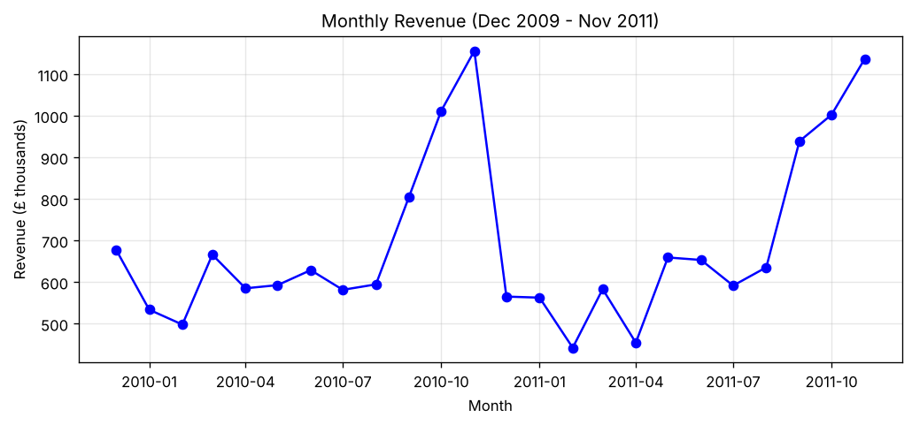
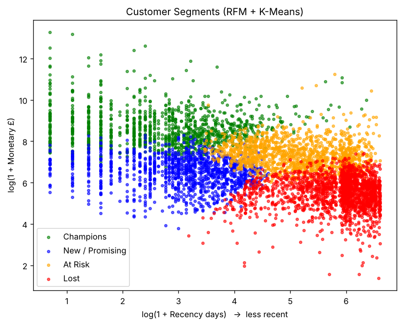
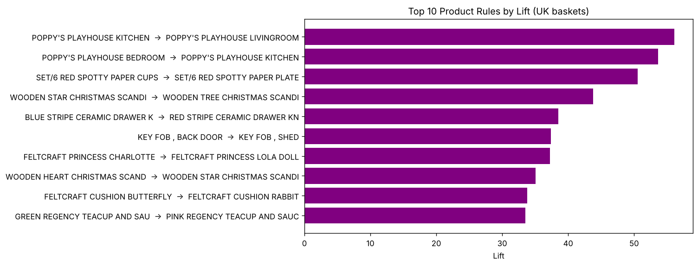
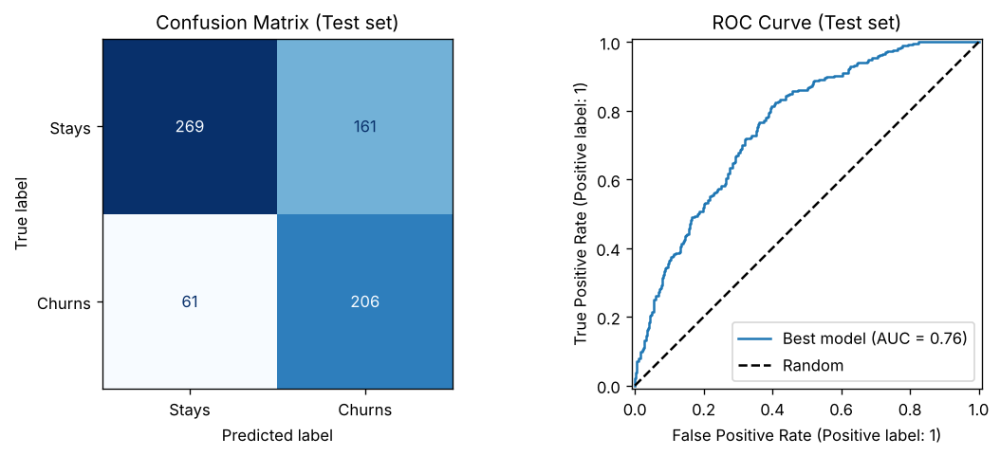

# Online Retail Customer Analytics

**Who are our customers, what do they buy together, and who is about to leave?**

An end-to-end machine-learning analysis of **776,577 cleaned transactions** from a UK-based online gift store (Dec 2009 – Dec 2011, 5,852 customers, £17.1M revenue). One dataset, three connected questions:

| # | Business question | Method | Key result |
|---|---|---|---|
| 1 | Who are our customers? | **RFM + K-Means** (elbow + silhouette), checked with hierarchical clustering | 4 segments; **Champions are 20% of customers but 73% of revenue** |
| 2 | What do they buy together? | **Apriori** association rules (UK baskets) | 142 strong rules; top pairs have **lift up to 56** |
| 3 | Which active customers will stop buying? | **Logistic Regression, KNN, SVM, Decision Tree, Random Forest**, 10-fold CV + GridSearchCV | Tuned Random Forest catches **77% of churners** (ROC-AUC 0.76) |

---

## 1. Data cleaning and exploration — [`01_data_cleaning_and_eda`](notebooks/01_data_cleaning_and_eda.ipynb)

The two raw files (1,067,371 rows) were cleaned step by step:

| Step | Rows removed |
|---|---|
| Duplicate rows (incl. the overlap between the two files) | 34,335 |
| Cancelled invoices (invoice number starts with "C") | 19,104 |
| Quantity ≤ 0 or price ≤ 0 (returns, adjustments) | 6,019 |
| Missing CustomerID (guest checkouts) | 228,488 |
| Non-product codes (postage, bank charges, manual entries) | 2,848 |
| **Clean rows left** | **776,577** |



- **Strong seasonality:** revenue peaks every November before Christmas (best month Nov 2010, £1.16M) and drops in early-year months (lowest Feb 2011, £0.44M).
- **Revenue is concentrated:** the top 20% of customers bring **77.2%** of revenue.
- **27.6%** of customers ordered only once. The UK brings **83.7%** of revenue.

## 2. Customer segmentation — [`02_customer_segmentation_rfm_kmeans`](notebooks/02_customer_segmentation_rfm_kmeans.ipynb)

Each customer is described by **Recency** (days since last order), **Frequency** (number of orders) and **Monetary** (total spend), log-transformed and standardised. K = 4 was chosen from the elbow curve and silhouette scores (0.365 for K = 4 vs 0.347 for K = 3; K = 2 scores higher but is too coarse to act on). Hierarchical clustering on a sample agreed well with K-Means (Adjusted Rand Index 0.73).



| Segment | % customers | % revenue | Median recency (days) | Median orders | Action |
|---|---|---|---|---|---|
| **Champions** | 20.2% | **73.3%** | 16 | 13 | Loyalty programme, account managers — protect them |
| **At Risk** | 24.9% | 16.9% | 184 | 4 | Win-back campaign and personal offers |
| **New / Promising** | 21.3% | 6.1% | 24 | 3 | Onboarding and second-order incentives |
| **Lost** | 33.6% | 3.7% | 401 | 1 | Low-cost reactivation only |

## 3. Market basket analysis — [`03_market_basket_apriori`](notebooks/03_market_basket_apriori.ipynb)

33,361 UK baskets (≈ 21 products each) → Apriori with min support 1%, min confidence 30%, min lift 3 → **142 rules**.



| If a customer buys… | …they also buy | Confidence | Lift |
|---|---|---|---|
| Poppy's Playhouse Bedroom | Poppy's Playhouse Kitchen | 85% | 53.6 |
| Pink Regency Teacup and Saucer | Roses Regency Teacup and Saucer | 80% | 28.9 |
| Set/6 Red Spotty Paper Cups | Set/6 Red Spotty Paper Plates | 77% | 50.5 |

**Recommendation:** the strongest pairs are pieces of the same product family that customers collect (playhouse rooms, teacup colours, matching tableware, Christmas decorations). Sell them as **ready-made sets**, show them as "customers also bought", and restock them together.

## 4. Churn prediction — [`04_churn_prediction`](notebooks/04_churn_prediction.ipynb)

**Setup (leak-free):** cut-off date 10 Sep 2011. Features use **only purchases before the cut-off** (Recency, Frequency, Monetary, Tenure, product variety, average order value). Label: **churn = no purchase in the next 90 days**. Only active customers (bought in the previous 180 days) are kept: 2,785 customers, 38.2% churn. 75/25 stratified train/test split.

**Model comparison (10-fold CV on the training set, scaler inside a pipeline):**

| Model | Accuracy | Recall | F1 | ROC-AUC |
|---|---|---|---|---|
| Logistic Regression | 70.2% | 52.5% | **57.4%** | **76.1%** |
| KNN | 67.2% | 52.6% | 55.1% | 70.0% |
| Kernel SVM | 70.2% | 47.5% | 54.9% | 74.5% |
| Decision Tree | 62.5% | 51.5% | 51.2% | 60.4% |
| Random Forest | 69.2% | 51.9% | 56.3% | 73.5% |

**Tuning:** GridSearchCV (10-fold, optimising F1) over Logistic Regression and Random Forest chose a **Random Forest with max_depth = 5 and balanced class weights** (CV F1 63.3%).

**Final test-set result (evaluated once):**

| Accuracy | Precision | **Recall** | F1 | ROC-AUC |
|---|---|---|---|---|
| 68.2% | 56.1% | **77.2%** | 65.0% | 76.2% |



- **Recall rose from ~52% to 77%** after tuning: the model now catches 206 of 267 real churners, at the cost of more false alarms. That's the right trade-off for a cheap retention email.
- **Top drivers:** order frequency and total spend, then product variety and recency.
- **Honest limitation:** the churners caught hold only **44.7%** of all churners' past revenue. The model is better at spotting small, infrequent buyers than big accounts that suddenly stop, so top accounts need a separate alert (e.g. when a customer's usual order gap is exceeded).

---

## Tech stack
Python · pandas · NumPy · scikit-learn (KMeans, AgglomerativeClustering, LogisticRegression, KNN, SVC, DecisionTree, RandomForest, Pipeline, GridSearchCV) · apyori · SciPy · Matplotlib

## How to run
1. Download the dataset: on Kaggle, search **"UCI Online Retail II Data Set"** (by Jill Wang) and download the zip. It contains `online_retail_09_10.csv` and `online_retail_10_11.csv`. The original is on the [UCI Machine Learning Repository](https://archive.ics.uci.edu/dataset/502/online+retail+ii).
2. Put both CSVs in a `data/` folder next to `notebooks/` (or attach the dataset to a Kaggle notebook — the path is found automatically).
3. `pip install -r requirements.txt`
4. Run the notebooks in order: 01 → 04.

## Data source
UCI Machine Learning Repository, *Online Retail II* (Chen, 2019), via Kaggle. Raw data is not stored in this repo because of its size.

## Repository structure
```
├── README.md
├── requirements.txt
├── notebooks/
│   ├── 01_data_cleaning_and_eda.ipynb
│   ├── 02_customer_segmentation_rfm_kmeans.ipynb
│   ├── 03_market_basket_apriori.ipynb
│   └── 04_churn_prediction.ipynb
├── images/          # plots used in this README
└── data/            # put the two CSV files here (not included)
```
